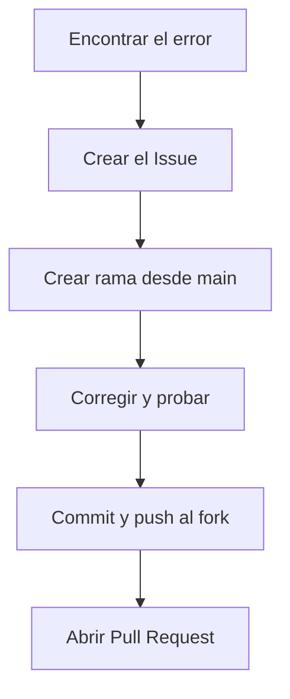

# Guia de contribucion

Gracias por querer mejorar Tienda TECSUP. Esta guia explica como
reportar errores, proponer mejoras y enviar cambios.

## Como reportar un error
1. Revisa en la pestana Issues que nadie lo haya reportado antes.
2. Crea un Issue nuevo con un titulo que diga el problema.
3. Responde estas cuatro preguntas en la descripcion:
   - Que esperabas
   - Que ocurre
   - Donde (archivo y funcion o linea)
   - Como reproducirlo

## Como proponer una mejora
1. Abre un Issue explicando que problema resuelve tu idea.
2. Describe tu propuesta de forma breve y concreta.

## Como enviar un cambio
Primero haz un fork del repositorio desde GitHub. Luego, en tu terminal:

```bash
# 1. Clona tu fork y entra a la carpeta
git clone https://github.com/lenin-usuriaga/tienda-tecsup.git
cd tienda-tecsup

# 2. Actualiza main
git pull

# 3. Crea una rama con nombre descriptivo
git checkout -b fix-nombre-del-error

# 4. Revisa tu cambio despues de corregir y probar en el navegador
git diff

# 5. Guarda el cambio
git add script.js
git commit -m "Describe tu cambio"

# 6. Sube la rama a tu fork
git push origin fix-nombre-del-error
```

Por ultimo, abre un Pull Request en GitHub y escribe `Cierra el issue #numero` en la descripcion.

## Flujo de contribucion


## Checklist antes de enviar tu Pull Request
- [] Parti de `main` actualizada
- [ ] Probe el cambio en el navegador
- [ ] Revise `git diff` y no hay lineas de prueba
- [ ] El Pull Request muestra solo los archivos que modifique
- [ ] Mencione el numero del issue en el commit y en la descripcion
- [ ] Mi commit tiene un mensaje que se entiende