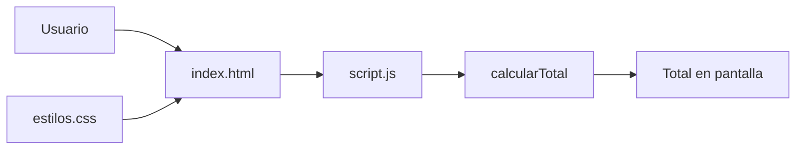

# Tienda TECSUP


Pagina web de un carrito de compras que muestra los productos elegidos,
sus cantidades y calcula el total a pagar. Pensada para estudiantes que
practican el trabajo colaborativo con Git y GitHub. Con los datos de
ejemplo, el total correcto es S/ 68.00.

## Tabla de contenidos
- [Instalacion](#instalacion)
- [Uso](#uso)
- [Estructura del proyecto](#estructura-del-proyecto)
- [Estado de las funciones](#estado-de-las-funciones)
- [Hoja de ruta](#hoja-de-ruta)
- [Arquitectura](#arquitectura)
- [Contribucion](#contribucion)
- [Autor](#autor)

## Instalacion
```bash
git clone https://github.com/lenin-usuriaga/tienda-tecsup.git
cd tienda-tecsup
```

## Uso
1. Abrir el archivo `index.html` en el navegador.
2. Revisar la tabla: 2 unidades de Polo TECSUP a S/ 25.00 y 1 unidad de Taza TECSUP a S/ 18.00.
3. Comprobar que la linea del total diga **S/ 68.00**.

El total se calcula en `script.js` multiplicando el precio de cada producto por su cantidad:
```js
function calcularTotal(lista) {
  let total = 0;
  for (const producto of lista) {
    total = total + producto.precio * producto.cantidad;
  }
  return total;
}
```

## Estructura del proyecto
| Archivo | Para que sirve |
|:--------|:---------------|
| index.html | La pagina: titulo, tabla del carrito y linea del total |
| estilos.css | Los colores y la tipografia de la pagina |
| script.js | El calculo del total |
| README.md | La descripcion del proyecto |
| CONTRIBUTING.md | La guia para colaborar |

La pagina enlaza sus estilos con esta linea:
```html
<link rel="stylesheet" href="estilos.css">
```

## Estado de las funciones
| Funcion | Estado | Prioridad |
|:--------|:------:|----------:|
| Mostrar la tabla del carrito | Listo | Alta |
| Calcular el total (precio por cantidad) | En revision | Alta |
| Cargar los estilos del curso | En revision | Media |

En revision significa que hay un Pull Request abierto esperando aceptacion.

## Hoja de ruta
- [x] Mostrar la tabla del carrito con sus productos
- [x] Reportar los dos errores con Issues
- [x] Proponer las correcciones con Pull Requests
- [ ] Integrar las correcciones al repositorio principal
- [ ] Agregar mas productos al carrito

## Arquitectura


## Contribucion
Lee la [guia de contribucion](CONTRIBUTING.md) antes de enviar cambios.

## Autor
Hecho por **Lenin Usuriaga** - [GitHub](https://github.com/lenin-usuriaga)